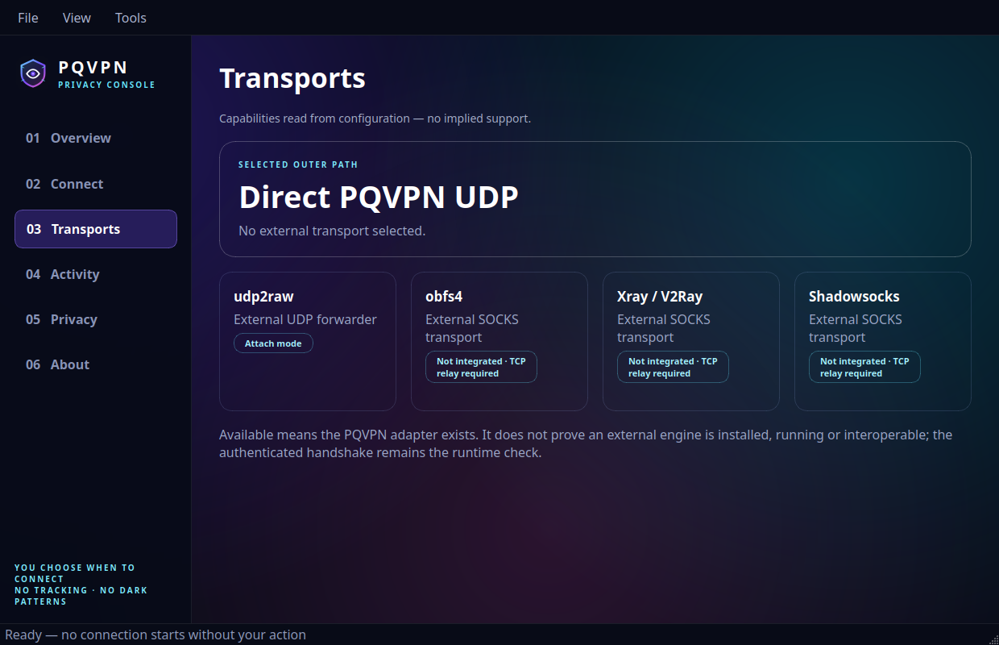
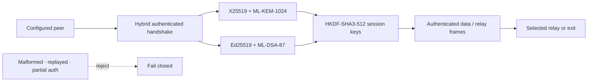

<div align="center">


# PQVPN

### Build a private path. Keep control of every key.

**An experimental, open-source VPN and peer network with hybrid post-quantum
handshakes, fail-closed routing, a native desktop app, and no required account
or hosted control plane.**

[](https://en.cppreference.com/w/cpp/23)
[](LICENSE)
[](#platforms-and-releases)
[](#security-and-project-status)

[Download a verified prerelease](https://github.com/tadaka9/PQVPN/releases) ·
[Project site](https://tadaka9.github.io/PQVPN/) ·
[Mainnet peers](https://tadaka9.github.io/PQVPN/mainnet/peers.json) ·
[Roadmap](ROADMAP.md)

</div>

---

## Privacy without surrendering the network

Most VPNs move trust from an ISP to a VPN operator. PQVPN is for people who
want another option: run the nodes, choose the peers, own the identities, and
inspect the code that protects the path.

PQVPN combines classical and post-quantum algorithms in every authenticated
session. It can operate as a direct peer link, a relay network, or a full
Linux tunnel through an exit node. The same C++23 core powers the desktop GUI,
terminal console, and automation-friendly CLI.

### Designed for practical anonymity

PQVPN is designed to hide the origin IP from destination services and reduce
linkability across the path: bootstrap, relay, and exit roles can be separated;
DNS follows the protected tunnel; IPv4 and IPv6 fail closed; multi-hop routes
limit what one intermediary can observe; and optional shaping changes simple
size/timing patterns. The intended anonymity set grows when independently
operated peers share relays and exits instead of every user running a unique,
identifiable route.

That protection is conditional. It requires a healthy tunnel and kill switch,
an exit that does not collude with the observer, enough concurrent users to
avoid a one-person anonymity set, and application hygiene: no personal login,
stable browser fingerprint, identifying cookie, or document metadata. The GUI
reports network protection; it cannot certify user behavior or promise
mathematical anonymity against a global passive adversary.

> PQVPN is experimental security software. It is not a promise of anonymity,
> an audited replacement for a mature VPN, or a way to make an untrusted exit
> trustworthy. Read [Security and project status](#security-and-project-status)
> before relying on it.

## What makes PQVPN different

| Capability | What it means |
|---|---|
| **Hybrid post-quantum sessions** | X25519 + ML-KEM-1024 establish key material; Ed25519 + ML-DSA-87 authenticate the same SHA3-512 transcript. Both halves are required. |
| **No required cloud account** | Peers are configured directly. Admission uses TOFU or an explicit allowlist; identities remain on your machines. |
| **Fail-closed tunnel policy** | Linux routes, DNS, IPv4/IPv6 handling, and the kill switch are applied as one owned state and rolled back on shutdown or failure. |
| **User-space exit node** | TCP and UDP egress can run without privileged packet forwarding on the exit host. Creating a local OS tunnel still requires the platform permissions expected for route and adapter changes. |
| **Adaptive transport** | PQTP can prefer UDP, fall back to TCP after bounded loss/jitter thresholds, and probe before returning to UDP. |
| **Traffic shaping you control** | Optional encrypted padding and bounded timing shaping are configured locally. No model download, telemetry, or payload inspection is involved. |
| **Verified transport engines** | The GUI can checksum, extract, start, and stop pinned udp2raw, Shadowsocks, V2Ray, and obfs4 builds where a native catalog entry exists. |
| **StrangeNet** | Ephemeral rooms run over authenticated PQVPN sessions with bounded messages, replay protection, explicit recipients, and an optional memory-only proof chain. |

## Native privacy console

<div align="center">


</div>

The Qt 6 desktop app turns configuration into a short, visible flow:

1. Choose and validate a profile.
2. Inspect the exact bootstrap, exit, tunnel, DNS, and peer policy.
3. Connect only after validation succeeds.
4. Watch authenticated session and tunnel-ready events.
5. Disconnect and restore the network state owned by PQVPN.

The **Transports** page exposes adaptive UDP/TCP policy, traffic-shaping
controls, engine configuration, verified installation, live start/stop state,
and actionable errors. The UI never treats a downloaded engine or an open
socket as proof that the VPN is connected.



## Try it

### Install a prerelease

Open [GitHub Releases](https://github.com/tadaka9/PQVPN/releases) and choose the
package for your platform. Each protected prerelease is assembled from a
successful five-target CI run and includes `SHA256SUMS` plus build metadata.

On Ubuntu, Debian, and compatible distributions:

```bash
sudo apt install ./pqvpn_*_amd64.deb
```

The package installs `pqvpn_monitor`, `pqvpn_tui`, and `pqvpn_node`. It does
not silently start a service or connect to a network.

### Build from source

The exact upstream dependency versions are pinned in
[`.github/dependencies.env`](.github/dependencies.env). A release build needs
CMake 3.28+, Ninja, a C++23 compiler, OpenSSL, Argon2, liboqs, and Qt 6 for the
desktop app.

```bash
git clone https://github.com/tadaka9/PQVPN.git
cd PQVPN

cmake -S . -B build -G Ninja \
  -DCMAKE_BUILD_TYPE=Release \
  -DPQVPN_BUILD_MONITOR=ON
cmake --build build --target pqvpn_node pqvpn_tui pqvpn_monitor
```

Validate before connecting:

```bash
./build/pqvpn_node --validate-config --config config.json
./build/pqvpn_node --platform-info
./build/pqvpn_monitor
```

## A minimal path

```text
your device                  bootstrap / relay                 exit node
┌──────────────┐  hybrid     ┌────────────────┐  authenticated ┌──────────────┐
│ pqvpn0 + DNS │════════════►│ peer you chose │═══════════════►│ user-space   │
│ kill switch  │◄════════════│ optional hop   │◄═══════════════│ egress       │
└──────────────┘  session     └────────────────┘  PQVPN frames  └──────────────┘
```

The repository ships reviewed example profiles. A profile selects bootstrap
peers, an optional exit, security policy, tunnel settings, adaptive transport,
and shaping limits. Private identity material is never embedded in release
artifacts.

```json
{
  "bootstrap": [
    { "host": "YOUR_BOOTSTRAP", "port": 9090 }
  ],
  "tunnel": {
    "interface_name": "pqvpn0",
    "exit_host": "YOUR_EXIT",
    "exit_port": 9090
  },
  "adaptive_transport": {
    "enabled": true,
    "mode": "auto"
  },
  "traffic_shaping": {
    "enabled": false,
    "max_padding_bytes": 1024,
    "max_delay_ms": 20
  }
}
```

See [configuration and external transports](docs/external-transports.md),
[mainnet operations](docs/mainnet-operations.md), and the
[update trust model](docs/update-system.md) before deploying a real path.

## Security model in one minute



- Both classical and post-quantum authentication components must verify.
- Session keys and directions are separated by HKDF-SHA3-512.
- Replay domains are bounded and independent.
- Parsers enforce size limits before allocation or state changes.
- Tunnel setup is transactional; owned routes, DNS, and firewall rules are
  removed during rollback.
- Engine downloads are pinned by SHA-256 and extracted to private user data.

More detail lives in the [release-readiness audit](docs/release-readiness-audit.md)
and [native qualification contract](docs/native-qualification-contract.md).

## Platforms and releases

Protected CI builds and exercises five native targets:

- Linux x86_64
- Linux ARM64
- Windows x86_64
- macOS x86_64
- macOS ARM64

The matrix compiles the node, TUI, and GUI; renders every GUI page in light,
dark, and compact layouts; tests scroll/navigation behavior; validates pinned
transport downloads on native runners; and runs package lifecycle gates.

Development happens on [`future`](https://github.com/tadaka9/PQVPN/tree/future).
Verified work is promoted to `main` under the
[branch policy](docs/branch-policy.md). Tags are immutable; releases are
published only from successful exact-tag CI artifacts.

## Security and project status

PQVPN is an ambitious experimental project, not yet independently audited.
The cryptographic building blocks are established algorithms, but the protocol
composition and implementation still require broader review and real-world
interoperability testing.

Use it for testing, learning, and controlled networks. Do not treat it as your
only safety layer in a high-risk environment. Endpoint compromise, traffic
analysis, malicious exits, browser identity, account correlation, and service
provider blocking remain outside what a VPN alone can solve.

Please report vulnerabilities privately using the instructions in
[SECURITY.md](SECURITY.md).

## Help build the network

Useful contributions include protocol review, hostile-network testing,
packaging, accessibility, native driver work, reproducible benchmarks, and
documentation that turns a failure into a clear next action.

1. Read [CONTRIBUTING.md](CONTRIBUTING.md).
2. Start from the `future` branch.
3. Keep claims tied to a test or observable runtime state.
4. Submit focused changes with the relevant regression coverage.

If the idea resonates, star the repository, test a prerelease, and share the
failure logs that help make the next build stronger.

---

<div align="center">

Created and maintained by [tadaka9](https://github.com/tadaka9) · MIT licensed

**Own the nodes. Own the keys. Verify the path.**

</div>
