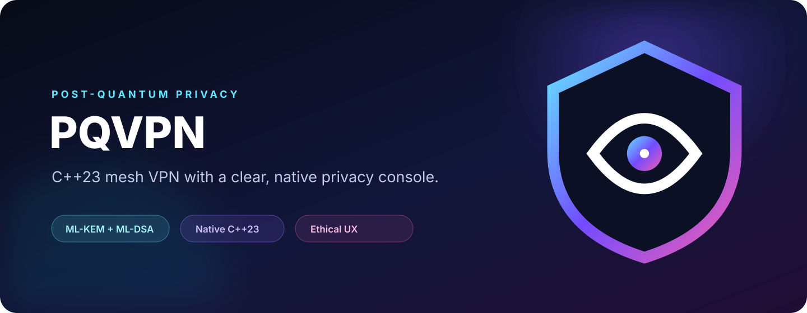
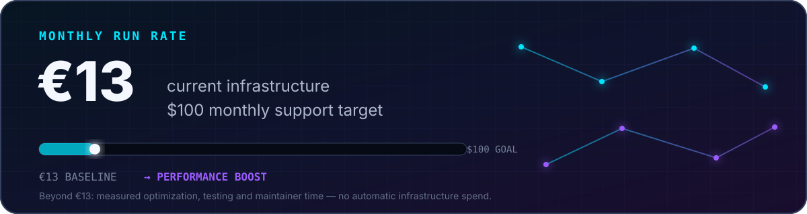
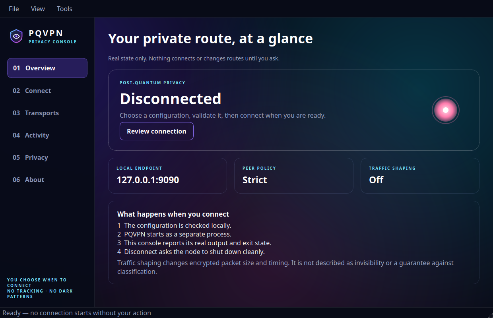

<div align="center">



# PQVPN

### WHAT IF THE NETWORK BELONGED TO THE PEOPLE RUNNING IT?

**Build a private path between machines you control. No account. No telemetry.
No central control plane.**

PQVPN is an open-source C++23 experiment in peer-to-peer networking, hybrid
post-quantum handshakes, user-operated relays, egress and encrypted peer chat.
It is ambitious, inspectable—and not yet independently audited.

[](https://en.cppreference.com/w/cpp/23)
[](LICENSE)
[](#evidence-not-promises)
[](#the-honest-status)



| Maintainer contribution | Verified spend this month | Expected monthly budget |
|---|---:|---:|
| **Davide Di Pino / [tadaka9](https://github.com/tadaka9)** · project creation, engineering, public bootstrap and exit-node operations | **€13 EUR** · current monthly infrastructure cost reported by the maintainer | **$100 USD** · servers, maintenance and response time |

<sub>€13 sustains the current server baseline. Support above that threshold is
the performance-boost zone: profiling, optimization, testing and maintainer
time—not an automatic or undisclosed increase in hosting spend.</sub>

[Try the experiment](#choose-your-first-move) ·
[See how it works](#the-60-second-model) ·
[Inspect the evidence](#evidence-not-promises) ·
[Join the work](#choose-your-contribution) ·
[Support PQVPN](#keep-the-experiment-alive)

</div>

---

## The invitation

Most privacy products ask you to trust a company, an account or an invisible
control plane. PQVPN asks a different question:

> **Can ordinary people operate the path, hold the keys and inspect every
> security claim for themselves?**

The answer is not a slogan. It is an experiment you can run.

Start one node. Connect a second. Add a relay. Observe what succeeds, what
fails closed and what still needs engineering. If something breaks, the result
belongs in a test—not behind marketing language.

## Why this experiment matters

Traffic captured today may outlive the cryptography protecting it. Meanwhile,
centralized VPNs move trust rather than eliminate it: the ISP sees less, but
the VPN operator sees more.

PQVPN explores another posture:

- **Hybrid cryptography:** classical and post-quantum algorithms participate
  in the same authenticated handshake.
- **Peer ownership:** bootstrap, relay and exit roles run on infrastructure
  chosen by their operators.
- **Visible boundaries:** unsupported paths fail explicitly instead of being
  presented as protected.
- **Evidence over authority:** protocol behavior, hardening rules and release
  gates live beside the source.

This does **not** prove anonymity, make operators trustworthy or replace an
independent audit. It creates something more useful than a promise: a system
that can be challenged, measured and improved in public.

## Choose your first move

You do not need to understand the entire protocol before participating.

| If you have… | Start here | What you contribute |
|---|---|---|
| **30 seconds** | [Star the repository](https://github.com/tadaka9/PQVPN) | Help another curious builder discover it. |
| **5 minutes** | Read [the honest status](#the-honest-status) | Decide whether the experiment fits your risk tolerance. |
| **15 minutes** | Build and run the local smoke test | Produce a reproducible result on one more machine. |
| **An extra server** | Operate a relay with egress disabled | Expand topology without becoming an exit. |
| **Security experience** | Read [`SECURITY.md`](SECURITY.md) and the threat-model work | Find the assumption everyone else missed. |
| **A stubborn bug** | Open a minimal, reproducible issue | Turn friction into shared evidence. |

The smallest useful commitment is intentionally small. You can stop after any
step and still leave the project better than you found it.

## The 60-second model

```text
     machine you control          optional relay          chosen exit
    ┌──────────────────┐       ┌────────────────┐      ┌──────────────┐
    │ app → TUN → node │ ═════ │ PQVPN peer    │ ════ │ user-space   │ → internet
    │ hybrid identity  │       │ egress OFF    │      │ egress ON    │
    └──────────────────┘       └────────────────┘      └──────────────┘
             │                          │                       │
             └──── authenticated, encrypted peer sessions ─────┘
```

1. **Discover** — a node contacts endpoints listed in `bootstrap`.
2. **Authenticate** — both peers bind classical and post-quantum material into
   one transcript.
3. **Establish** — role-separated session keys protect PQVPN frames.
4. **Route** — traffic follows the peer/relay/exit policy you configured.
5. **Reject** — malformed frames, stale nonces and partial authentication fail
   closed.

The **Transports** page also exposes the same adaptive policy, traffic shaping
and optional [WireGuard/OpenVPN client inside PQVPN](docs/inner-tunnels.md) as
the CLI and TUI. An installed helper or open socket is never presented as proof
that the protected route is connected.

There is no hosted account database or mandatory coordination service. There
is still trust: in the code you run, the peers you admit, the machines you
operate and the evidence you have verified.

## What exists today

| Capability | Current behavior |
|---|---|
| **Hybrid session setup** | X25519 + ML-KEM-1024 key establishment; Ed25519 + ML-DSA-87 authentication; SHA3-512 transcript and HKDF derivation. |
| **Peer and relay paths** | Configured bootstrap peers, replay-bounded sessions and onion relay layers bound to their intended forwarders. |
| **User-space egress** | TCP/UDP bridging, IPv4/IPv6 handling, fragment reassembly and bounded multi-client flow state. |
| **Native clients** | One configuration model exposed through the node CLI, terminal console and Qt Privacy Console. |
| **Adaptive transport policy** | UDP-preferred policy with bounded measurements, hysteresis and explicit fallback state. |
| **StrangeNet** | Encrypted, authenticated peer rooms with bounded messages, replay checks and rate limits. |
| **Release integrity** | Versioned packages, checksums, deterministic update containers and CI evidence gates. |

### DNS Shield: choose once, see the trade-off

The Linux Privacy Console can apply a complete Pi-hole preset with one button.
The packaged application performs one narrowly scoped administrator action:
the helper accepts a named preset, adds only the reviewed source URLs below,
validates optional custom expressions and rebuilds gravity. It cannot execute
an arbitrary command or accept an arbitrary database path.

| Preset | Coverage | Expected friction | Best fit |
|---|---|---:|---|
| **Balanced privacy** · recommended | OISD Big | Low–moderate | Everyday blocking with fewer surprises |
| **Threat defence** | OISD Big + HaGeZi TIF | Low–moderate | Malware, phishing and command-and-control defence |
| **Family boundaries** | Threat defence + adult and gambling categories | Intentional restrictions | A household policy discussed with the people it affects |
| **Maximum** · expert | HaGeZi Pro + TIF + family categories | Higher | Operators prepared to diagnose false positives |

```text
Privacy Console → Shield → choose a preset → Apply shield in one click
```

Pi-hole must already be installed locally. PQVPN does not silently install a
DNS server, change a remote Pi-hole or pretend that DNS filtering can inspect
encrypted page content. The shield displays aggregate counts only; it does not
import query history, client addresses or browsing profiles. Category filters
are a configurable safety aid—not surveillance, a substitute for conversation
or a guarantee of child safety.

The preset design is inspired by the unusually clear selection guidance in
[HaGeZi DNS Blocklists](https://github.com/hagezi/dns-blocklists). Filter data
comes from [HaGeZi](https://github.com/hagezi/dns-blocklists) and
[OISD](https://oisd.nl/); those projects remain independent and their own
documentation is authoritative for list contents, licensing and updates.

### StrangeNet: conversation without a platform account

StrangeNet sends a separately encrypted room message to established,
authenticated PQVPN sessions. It is deliberately bounded: 2 KiB messages,
per-peer and room-wide token buckets, monotonic replay guards and a capped
direct broadcast set. Groups never create a server-held or participant-owned
central secret: every member receives different ciphertext under the hybrid
session that member helped establish. A group send fails closed unless the
entire pinned membership is authenticated and ready.

```bash
./build/pqvpn_node --config config.json \
  --strangenet-room riemann-lab
```

Use `--strangenet-peer 64_HEX_DIGITS` to restrict a room to one authenticated
peer. Read [`docs/strangenet.md`](docs/strangenet.md) before treating it as more
than an experimental communication layer.

## The cryptographic boundary

| Layer | Policy | What it is meant to provide |
|---|---|---|
| Authentication | Ed25519 **and** ML-DSA-87 | Both signatures cover the same transcript digest; partial authentication is rejected. |
| Key establishment | X25519 **and** ML-KEM-1024 | Classical and post-quantum shared secrets are combined, not selected as alternatives. |
| Derivation | HKDF-SHA3-512 | Role-separated keys, IV material and a bound session identifier. |
| Local password KDF | Argon2id | Salt and cost enforcement with explicit provider failure. |
| Replay defense | Monotonic counters and bounded windows | Separation between tunnel-data and relay-layer replay domains. |

These ingredients are not a security certificate. Correct algorithms can
still be composed incorrectly, implementations can contain bugs and endpoints
can be compromised. PQVPN needs adversarial review precisely because its goals
are serious.

## Quickstart: run the evidence before the network

### 1. Build

Install CMake 3.28+, Ninja, a C++23 compiler, pkg-config and the upstream
dependency versions pinned in [`.github/dependencies.env`](.github/dependencies.env).

```bash
git clone https://github.com/tadaka9/PQVPN.git
cd PQVPN

cmake -S . -B build -G Ninja \
  -DCMAKE_BUILD_TYPE=Release \
  -DBUILD_TESTING=OFF
cmake --build build --target pqvpn_node
```

### 2. Inspect and validate

```bash
./build/pqvpn_node --version
./build/pqvpn_node --platform-info
./build/pqvpn_node --validate-config --config config.json
./build/pqvpn_node --smoke-test --config config.json
```

The checked-in [`config.json`](config.json) is the experimental mainnet
profile. It uses UDP `9090` and the opt-in Helsinki bootstrap published in the
[versioned peer registry](https://tadaka9.github.io/PQVPN/mainnet/peers.json).
Review every listener, peer and TOFU decision before starting it.

### 3. Run deliberately

```bash
./build/pqvpn_node --config config.json
```

Stop with <kbd>Ctrl</kbd>+<kbd>C</kbd>. A relay or exit can run without a local
tunnel adapter. A full-device tunnel requires operating-system networking
support and, on Linux, appropriate TUN/network-administration privileges.

### Linux packages

Verified prereleases may include `.deb` packages for x86-64 and ARM64:

```bash
sudo apt install ./pqvpn_*.deb
```

Packages install `pqvpn_node`, `pqvpn_tui`, `pqvpn_monitor`, service units and
example configuration. They do not silently opt a machine into the network.
Review and validate the configuration first. See
[`docs/mainnet-operations.md`](docs/mainnet-operations.md) for a managed relay.

## One model, three interfaces

PQVPN aims for the same validated configuration and runtime semantics across
the CLI, terminal console and desktop console.

### CLI

The canonical automation and runtime interface:

```bash
./build/pqvpn_node --validate-config --config config.json
./build/pqvpn_node --print-config --config config.json
./build/pqvpn_node --help
```

### TUI

`pqvpn_tui` is the dependency-light console for SSH sessions and systems
without Qt:

```bash
cmake --build build --target pqvpn_node pqvpn_tui
./build/pqvpn_tui --config config.json
```

### Privacy Console

The Qt 6 interface guides configuration, verification and connection while
keeping protocol, routing and cryptography in `pqvpn_node`:

```bash
cmake -S . -B build -G Ninja \
  -DCMAKE_BUILD_TYPE=Release \
  -DBUILD_TESTING=OFF \
  -DPQVPN_BUILD_MONITOR=ON
cmake --build build --target pqvpn_node pqvpn_monitor
./build/pqvpn_monitor
```

It does not auto-connect, simulate success or silently install an update.
Reduced-motion support disables ambient and transition animation.

<div align="center">



<sub>The real Qt application rendered through its offscreen smoke test.</sub>

</div>

## Evidence, not promises

Every pull request and push to `future` or `main` enters a native build and
smoke-test matrix:

| Target | Runner baseline | Toolchain |
|---|---|---|
| Linux x86_64 | Ubuntu 24.04 | GCC + Ninja |
| Linux ARM64 | Ubuntu 24.04 ARM | GCC + Ninja |
| macOS Intel | macOS 15 Intel | AppleClang |
| macOS Apple Silicon | macOS 15 | AppleClang |
| Windows x86_64 | Windows 2025 | MSVC + vcpkg |

The test graph covers handshake, key derivation, replay defense, relay
forwarding, egress behavior, configuration validation, adapters, packaging and
the `pqvpn_hard_kernel` security gate. CodeQL runs for C/C++.

Run the same core suite locally:

```bash
cmake -S . -B build-test -G Ninja \
  -DCMAKE_BUILD_TYPE=Debug \
  -DBUILD_TESTING=ON
cmake --build build-test -j2
ctest --test-dir build-test --output-on-failure -j2
```

A green matrix means those checks passed for that commit. It does not establish
real-world anonymity or substitute for native deployment tests and an
independent security audit.

## The honest status

> [!WARNING]
> **PQVPN is experimental software. It has not received an independent security
> audit. Do not rely on it for personal safety, source protection, evading a
> capable adversary or any situation where failure has serious consequences.**

Use disposable test environments, keep exposure narrow and verify the exact
commit and configuration you run. Current release blockers and milestones are
tracked in [`ROADMAP.md`](ROADMAP.md).

Known boundaries include:

- platform tunnel integration and privileged lifecycle coverage are not equal
  across every target;
- Windows public driver loading requires the appropriate signing path;
- transport adapters have explicit capability limits and never imply support
  for an unimplemented TCP/SOCKS bridge;
- operator trust, endpoint security, traffic analysis and metadata remain part
  of the threat model;
- the public experimental mainnet is infrastructure for testing, not proof of
  anonymity.

Trust the boundary because it is visible—not because the project asks you to
ignore it.

## Configuration in one glance

| Section | Important fields | Purpose |
|---|---|---|
| `network` | `port`, `bind_address` | UDP listener. |
| `bootstrap` | `host:port` entries | Peers contacted until a session exists. |
| `security` | TOFU, allowlist, known peers, KDF policy | Admission and local key policy. |
| `tunnel` | enabled state, interface and exit policy | Selects relay-only or full-tunnel behavior explicitly. |
| `egress` | enabled state and limits | Controls whether a node may open outbound flows. |
| `tuning` | timeouts, keepalive, replay window | Bounded session and liveness behavior. |
| `adaptive_transport` | mode and thresholds | UDP/TCP lane selection policy. |
| `traffic_shaping` | opt-in limits | Optional delay/padding behavior; disabled unless configured. |

Use `--print-config` and `--validate-config`; do not infer runtime behavior from
an old example. The parser and runtime share the same validation contract.

## Choose your contribution

PQVPN does not need spectators pretending the experiment is finished. It needs
people who can make one claim more testable.

- **Break it responsibly:** follow [`SECURITY.md`](SECURITY.md) for private
  vulnerability reports.
- **Reproduce a failure:** use the issue templates and include the smallest
  safe configuration that demonstrates it.
- **Test another platform:** record the commit, package, architecture and
  observable result.
- **Improve the model:** review the roadmap, network policy and release gates.
- **Write focused code:** read [`CONTRIBUTING.md`](CONTRIBUTING.md) and target
  `future`; `main` remains the protected promotion branch.

Useful maps:

- [`ROADMAP.md`](ROADMAP.md) — evidence still needed before production claims
- [`docs/network-policy-roadmap.md`](docs/network-policy-roadmap.md) — routing,
  kill-switch and split-tunnel contract
- [`docs/competitive-parity.md`](docs/competitive-parity.md) — desktop parity
  gates
- [`docs/strangenet.md`](docs/strangenet.md) — encrypted room behavior
- [`docs/update-system.md`](docs/update-system.md) — update trust and rollback
- [`docs/external-transports.md`](docs/external-transports.md) — transport
  attachment boundaries

## Repository map

```text
PQVPN/
├── src/                    node, protocol modules and native clients
├── include/                public project headers
├── tests/                  unit, integration, packaging and security tests
├── tools/                  hardening and release validation
├── packaging/              native packages and verified update containers
├── docs/                   protocol, operations and product boundaries
├── CMakeLists.txt          build and test graph
└── ROADMAP.md              evidence required for the next milestone
```

---

<div align="center">

## Keep the experiment alive

The most valuable contribution is evidence: a test result, a careful review,
a reproducible bug or a focused patch.

### $100 each month: infrastructure and time

The monthly target is **$100 USD**. Contributions first help keep the public
bootstrap and exit infrastructure available; the remainder supports focused
maintenance, testing, documentation and incident response time. This is a
target—not a claim that the amount has already been collected.

The maintainer currently reports **€13 EUR in monthly infrastructure spend**.
Once that baseline is covered, additional support becomes a transparent
**performance boost**: engineering time for profiling, throughput work,
reliability tests and measured optimization. It does not trigger automatic
server purchases or hidden recurring costs.

PQVPN does not display a fabricated live progress percentage. Progress should
be updated only from records the maintainer can verify, and server costs remain
subject to provider invoices and exchange rates.

If you want to help discovery, **[star PQVPN](https://github.com/tadaka9/PQVPN)**.
If you want to help engineering, **[choose an issue](https://github.com/tadaka9/PQVPN/issues)**.
If you want to fund CI and continued development, read
**[`docs/SUPPORT.md`](docs/SUPPORT.md)** and verify every payment address in this
repository before sending anything.

- **Bitcoin:** `bc1qt6lrt8ces62pvp6ws9audr5mdhu0ht9qkga2ll`
- **SEPA:** `DE29100110012626679655` — beneficiary: Davide Di Pino

Donations purchase no influence, support guarantee or security assurance.
They simply give an open experiment more time to become measurable.

**Run it. Question it. Improve it.**

Created and developed by [tadaka9](https://github.com/tadaka9), with community
contributions accepted under the [MIT License](LICENSE).

[Project site](https://tadaka9.github.io/PQVPN/) ·
[Releases](https://github.com/tadaka9/PQVPN/releases) ·
[Peer registry](https://tadaka9.github.io/PQVPN/mainnet/peers.json) ·
[Report an issue](https://github.com/tadaka9/PQVPN/issues/new/choose)

</div>
